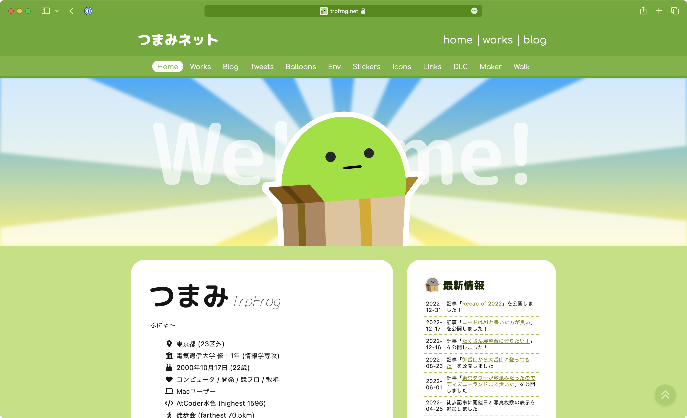

<p align="center">
  <a href="https://trpfrog.net">
    
  </a>
</p>

<h1 align="center">trpfrog.net</h1>
<p align="center">
  A monorepo for my personal website, <a href="https://trpfrog.net">trpfrog.net</a>, built with Next.js and TypeScript.
</p>



## 🔐 Environment variables and deployment

1Password is the source of truth for secrets. Each app has `.tpl` files containing `op://` references, so no value is stored in the repository.

| File | Purpose |
| --- | --- |
| `apps/*/.env.local.tpl`, `apps/image-generation/.dev.vars.tpl` | Local development (`Development` vault) |
| `apps/image-generation/.prod.vars.tpl` | Worker Secrets (`Production` vault) |
| `apps/trpfrog.net/.prod.vars.tpl` | Vercel variables (`Production` vault) |

```sh
vp run -r secrets:dev               # writes .env.local and .dev.vars, overwriting existing files
vp run --filter trpfrog.net env:push --dry-run  # prints the changes to Vercel
vp run --filter trpfrog.net env:push            # applies them; redeploy to pick them up
```

### Deployment

- Workers deploy on pushes to `main` that touch their sources (`deploy-content-server.yml`, `deploy-image-generation.yml`), or manually from the Actions tab.
- Vercel variables are pushed manually by the `Push Vercel env` workflow, which defaults to a dry run.
- Vercel skips builds with no change relevant to the website (`apps/trpfrog.net/tools/ignoreBuild.sh`).

### First-time setup

1. In 1Password, create a Login or Secure Note item named `trpfrog.net` in both the `Development` and `Production` vaults, with one field per key in the templates.
2. In the `Production` vault, create an item named `trpfrog.net-deploy` with these fields:
   - `CLOUDFLARE_API_TOKEN`: edit access to Workers Scripts, Workers KV Storage, Workers R2 Storage, D1, Workers Routes and the DNS of the zone, plus read access to Account Settings
   - `CLOUDFLARE_ACCOUNT_ID`
   - `VERCEL_TOKEN`, `VERCEL_ORG_ID`, `VERCEL_PROJECT_ID`
3. Create a 1Password Service Account with read-only access to the `Production` vault.
4. Create a GitHub Environment named `deploy`, limit its deployment branches to `main`, and add the Service Account token as the `OP_SERVICE_ACCOUNT_TOKEN` secret.

## 🧩 Technology Stack

- **Node.js**
- **TypeScript** with `better-typescript-lib`
- **Vite+** for linting, formatting, and testing
- **Tailwind CSS**
- **React** (with React Compiler)
- **pnpm**
- **Turborepo** for monorepo management
- **Valibot** for schema validation
- **ts-pattern** for pattern matching

### trpfrog.net

- **Next.js** for building the website
- **Vercel** for website hosting
- **CSS Modules** for *complex* styling
- **Vanilla Extract** for *more complex* styling
- **Hono** for BFF (`hono/vercel`) and middlewares
- **Cloudinary** for image CDN
- **next-mdx-remote** for rendering blog articles from Markdown
- **OpenAI API** for resolving ambiguous URLs (`trpfrog.net/fuzzy`)
- **microCMS** for hosting draft articles
- ~~**PlanetScale** for database of Twitter archives~~
  - Due to the discontinuation of PlanetScale's hobby plan, we are planning to migrate to Cloudflare D1.

### trpfrog-diffusion (AI-powered TrpFrog Icon Generation)

- **Hono** for API endpoints
- **Cloudflare Workers** for hosting the API
- **OpenAI API** for generating prompt
- **Gemini API** for image generation (nano-banana)
- **Cloudflare Workers KV** for caching generated images
- **Cloudflare D1** for storing metadata of generated images
- **Drizzle ORM** for interacting with Cloudflare D1
- **Cloudflare R2** for storing generated images

### dev-blog-server

- **Hono** for API endpoints

### content-server

- **Hono** for API endpoints
- **Cloudflare Workers** for hosting the API

and so on...

## 🐤 Getting Started

First, install the dependencies:

```sh
pnpm install
```

Next, run the development server:

```sh
pnpm -w dev
```

Open [http://localhost:3000](http://localhost:3000) with your browser to see the result.

Useful workspace commands:

```sh
pnpm -w build
pnpm -w test
pnpm -w lint-fix
pnpm -w type-check
pnpm -w typegen
```

This repository uses **Vite+** under the hood for linting, formatting, and tests. Running the workspace scripts above is the simplest way to use the configured toolchain.

## 🚗 Requirements

- Node.js 20.x
- pnpm 10.x

## 📦 Project Structure

We are using a monorepo. The package structure is as follows.

```
.
├── apps                    # Applications
│   ├── admin                 # Admin app
│   ├── content-server        # API server for content-related features
│   ├── dev-blog-server       # SSE server for editing blog posts
│   ├── image-generation      # API endpoints for trpfrog-diffusion
│   └── trpfrog.net           # Main website
├── packages                # Libraries
│   ├── config-typescript     # Shared TypeScript config
│   ├── constants             # Constants used by some packages
│   ├── posts                 # Utilities for posts
│   └── utils                 # Utilities used by some packages
├── posts/                  # Blog posts
│   └── *.md
├── README.md
├── package.json
├── pnpm-lock.yaml
├── pnpm-workspace.yaml
├── turbo.json
└── vite.config.ts
```

## 💚 Contribution

**Welcome!** and thank you for your interest in contributing! Please keep the following in mind:

1. **No Major \*Content\* Changes or Additions**
   This is a personal site by @trpfrog. Major content changes or new additions that might alter the original intent of the website are not accepted.

2. **License Notice**
   This project may switch to the **MIT License** in the future. Contributions will follow the same license at that time.

3. **Improvements and Suggestions Welcome**
   Improvements, such as refactoring or typo fixes, are welcome through Pull Requests.
   We also welcome new content ideas and suggestions via Issues.

Thank you for your understanding and support!
